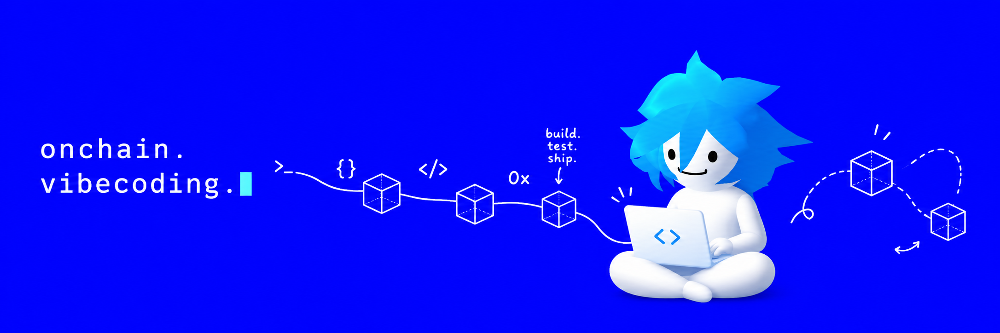

<p align="center">
<a href="https://x.com/ventry089"></a>


</p>

## hey

i'm ventry. i build on solana.

spent the last two months measuring the chain instead of trading it - how transactions actually land, and whether any of the advice people repeat holds up.

most of it doesn't.

## what i measured

```
on-chain data collected     ████████████████████  211 GB
my own trades, logged       ████████████████      1,281
tokens traced from launch   ██████████████        1,148
videos parsed for rules     ████████              631   (268 channels)
rules that survived         █                     1 of 8
```

that last line is the interesting one.

## open

| | |
|---|---|
| **[leader-radar](https://github.com/ventry08/leader-radar)** | which validator client holds the solana ledger right now, and what that does to your transaction. no deps, no key |
| **rank-cost** | how transactions actually get ordered - requested CU, loaded-data limits, tip lanes `soon` |
| **signals-tested** | 15 entry signals against 1,148 tokens, with base rates `soon` |

## writing

- **buying a memecoin moves 13 megabytes** - inside the speed race `soon`
- **seven rules that are noise** - the niche's checklist, measured `soon`

## stack

`python` · `rust` · `playwright` · `helius` · `jito` · `yellowstone gRPC` · `claude code`

---

<sub>no signals, no calls, no paid group. numbers come with the file and the date.</sub>
